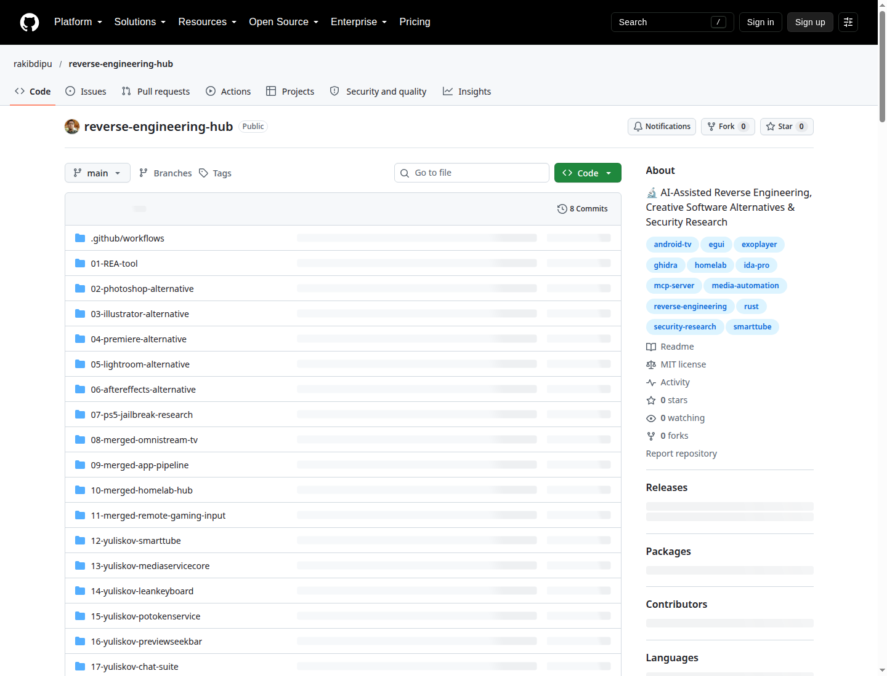

# 🔬 Reverse Engineering & Automation Mega Hub

> **AI-Assisted Reverse Engineering, Creative Software Alternatives, Android TV Streaming & Low-Level OS Internals**

[](https://opensource.org/licenses/MIT)
[]()
[]()

---

## 📸 প্রিভিউ (Live Repository Preview)



---

## 📋 প্রজেক্ট ওভারভিউ (Project Overview)

এই রিপোজিটরিতে বিশ্বের শীর্ষস্থানীয় ৩ জন বিশেষজ্ঞ ওপেন-সোর্স ডেভেলপার ([@yuliskov](https://github.com/yuliskov), [@WitherOrNot](https://github.com/WitherOrNot), [@stevietv](https://github.com/stevietv)) এবং আধুনিক AI রিভার্স-ইঞ্জিনিয়ারিং গবেষণার সেরা **৫০+ প্রকল্প** পৃথক পৃথক ফাইলে সংগঠিত করে উপস্থাপন করা হয়েছে।

---

## 🗂️ সম্পূর্ণ প্রজেক্ট স্ট্রাকচার (Repository Structure)

```
reverse-engineering-hub/
│
├── 📁 01-07: REVERSE ENGINEERING & CREATIVE SUITE
│   ├── 01-REA-tool/                    # REA: Reverse Engineer Anything (AI+Ghidra+IDA)
│   ├── 02-photoshop-alternative/       # PhotoCraft — Adobe Photoshop বিকল্প (PSD RE)
│   ├── 03-illustrator-alternative/     # VectorCraft — Adobe Illustrator বিকল্প (Bezier RE)
│   ├── 04-premiere-alternative/        # FilmCraft — Adobe Premiere Pro বিকল্প (PRPROJ RE)
│   ├── 05-lightroom-alternative/       # LightCraft — Adobe Lightroom বিকল্প (LRCAT SQLite RE)
│   ├── 06-aftereffects-alternative/    # EffectCraft — Adobe After Effects বিকল্প (AEP RIFX RE)
│   └── 07-ps5-jailbreak-research/      # PS5 Jailbreak ও কনসোল ফার্মওয়্যার সিকিউরিটি
│
├── 📁 08-11: UNIFIED MERGED MEGA-PROJECTS (নতুন উদ্ভাবনী প্রজেক্ট)
│   ├── 08-merged-omnistream-tv/        # OmniStream TV (SmartTube + InnerTube + Plex + Trakt)
│   ├── 09-merged-app-pipeline/         # Zero-API Headless App & Media Pipeline (gplayapi + uupget + mpclient)
│   ├── 10-merged-homelab-hub/          # Homelab Media Hub (homepage + Flemmarr + speedtest)
│   └── 11-merged-remote-gaming-input/  # Virtual Remote Gaming Controller (chunithm + LeanKeyboard + QEMU)
│
├── 📁 12-18: ANDROID TV & STREAMING ECOSYSTEM (yuliskov)
│   ├── 12-yuliskov-smarttube/          # SmartTube & SmartTubeLegacy 4K HDR Player
│   ├── 13-yuliskov-mediaservicecore/   # InnerTube API Extractor & Signature Decipher
│   ├── 14-yuliskov-leankeyboard/       # Android TV D-pad Remote IME Keyboard
│   ├── 15-yuliskov-potokenservice/     # YouTube Proof of Origin Bot Bypass Service
│   ├── 16-yuliskov-previewseekbar/     # Thumbnail Video Timeline Scrub Bar
│   ├── 17-yuliskov-chat-suite/         # Compose + Spring Boot WebSockets Chat Suite
│   └── 18-yuliskov-system-tweaks/      # Windows & Padavan Router Streaming Tweaks
│
├── 📁 19-31: OS INTERNALS & EMULATION (WitherOrNot)
│   ├── 19-witherornot-xenonrecomp-xeo3/# Xbox 360 Static Recompiler for XEO3
│   ├── 20-witherornot-startxback/      # In-Memory Hook & Patcher for Windows Shell
│   ├── 21-witherornot-musedash-dlc-unlock/ # Unity Harmony Runtime Memory Patching
│   ├── 22-witherornot-warbird-docs/    # Microsoft Warbird DRM & Obfuscation Internals
│   ├── 23-witherornot-cbsexploder-sxsfounder/ # Windows CBS & WinSxS Tooling
│   ├── 24-witherornot-uupget/          # Official Windows Update UUP Client
│   ├── 25-witherornot-winkeycheck-licensing/ # PIDGen Validator & Licensing Research
│   ├── 26-witherornot-ohook/           # Universal Office SPP Hook & DLL Proxy
│   ├── 27-witherornot-mpclient/        # Standalone C Client for Defender mpengine.dll
│   ├── 28-witherornot-gplayapi/        # Headless Google Play Store API Client
│   ├── 29-witherornot-qemui/           # Modern C# Desktop GUI for QEMU
│   ├── 30-witherornot-ntfstool/        # NTFS Forensics & BitLocker Recovery
│   └── 31-witherornot-console-hacks/   # Nintendo Switch Tegra Payloads & Wii U Decrypt
│
├── 📁 32-39: HOMELAB & MEDIA AUTOMATION (stevietv)
│   ├── 32-stevietv-sonarr-radarr/      # Sonarr & Radarr PVR Automation
│   ├── 33-stevietv-prowlarr/           # Centralized Torznab/Newznab Proxy
│   ├── 34-stevietv-flemmarr/           # Configuration-as-Code for *arr Stack
│   ├── 35-stevietv-plektraktsync/      # Local Plex to Trakt.tv Bi-directional Sync
│   ├── 36-stevietv-plex-subs/          # Automated Plex Subtitle Configuration
│   ├── 37-stevietv-homepage-dashboard/ # Customizable Homelab Service Dashboard
│   ├── 38-stevietv-speedtest-analyser/ # Periodic Network Speed Monitor with Web UI
│   └── 39-stevietv-vehicle-telematics/ # Hyundai/Kia UVO Connected Car API Client
│
└── 📁 docs/
    ├── REFERENCES.md                   # সমস্ত রেফারেন্স আর্টিকেলের তালিকা
    └── TOP_50_PROJECTS_CATALOG.md      # সম্পূর্ণ ৫০টি প্রকল্পের পুঙ্খানুপুঙ্খ ক্যাটালগ
```

---

## 🚀 দ্রুত শুরু করুন (Quick Start)

```bash
# রিপোজিটরি ক্লোন করুন
git clone https://github.com/rakibdipu/reverse-engineering-hub.git
cd reverse-engineering-hub

# বিস্তারিত ৫০টি প্রজেক্টের ক্যাটালগ দেখতে:
cat docs/TOP_50_PROJECTS_CATALOG.md

# OmniStream TV মার্জ প্রজেক্ট পরীক্ষা করতে:
cd 08-merged-omnistream-tv
python3 omnistream_core.py
```

---

## 📚 এক্সটার্নাল রেফারেন্স ও ক্রেডিট

| রেফারেন্স | লিংক | বিষয়বস্তু |
|-----------|------|-----------|
| **Yuriy L (yuliskov)** | [github.com/yuliskov](https://github.com/yuliskov) | SmartTube, MediaServiceCore, LeanKeyboard |
| **WitherOrNot** | [github.com/WitherOrNot](https://github.com/WitherOrNot) | XenonRecomp, StartXBack, uupget, mpclient |
| **StevieTV** | [github.com/stevietv](https://github.com/stevietv) | Sonarr, Radarr, Prowlarr, PlexTraktSync |
| **REA Tool** | [CyberSecurityNews](https://cybersecuritynews.com/reverse-engineer-anything-tool/) | AI + Ghidra/IDA Pro integration |
| **PS5 Jailbreak** | [Gizmodo](https://gizmodo.com/the-jailbreak-floodgates-are-opening-for-sonys-playstation-2000823193) | Console Firmware & AI Acceleration |
| **CraftApps Suite** | [github.com/storytold](https://github.com/storytold) | Rust-based Clean-room Adobe Alternatives |

---

## ⚠️ ডিসক্লেইমার

> এই রিপোজিটরির সমস্ত তথ্য এবং সোর্স কোড **শুধুমাত্র শিক্ষামূলক এবং গবেষণার উদ্দেশ্যে** প্রদান করা হয়েছে। যেকোনো থার্ড-পার্টি বাইনারি বিশ্লেষণের ক্ষেত্রে আঞ্চলিক আইন ও প্রযোজ্য নীতিমালা মেনে চলুন।

---
*Made with ❤️ by [MD. RaKib Hassan Dipu](https://github.com/rakibdipu)*
